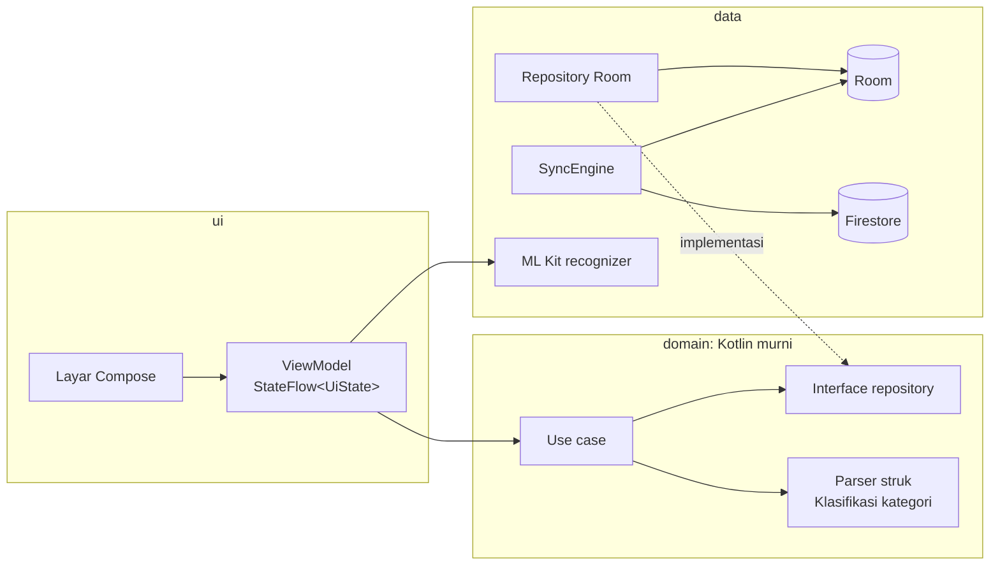

# MySavings

*[Read in English](README.md)*

Aplikasi keuangan pribadi untuk Android. Kamu bisa mencatat pengeluaran, menabung untuk barang yang diinginkan, dan memantau hutang yang masih harus dibayar.

Awalnya saya membuat aplikasi ini sebagai pencatat pengeluaran sederhana yang bisa membaca struk lewat kamera. Lama-lama fiturnya bertambah sampai punya empat tab: **Pengeluaran**, **Tabungan**, **Hutang**, dan **Profil**. Ini proyek portofolio, jadi kerapian kode sama pentingnya dengan fiturnya.

Aplikasi ini tetap jalan tanpa internet. Scan struk diproses langsung di HP, dan semua data tersimpan di database lokal. Login dengan Google tidak wajib, gunanya hanya untuk sinkron data antar perangkat.

<!--
Screenshot: simpan file PNG di docs/screenshots/ lalu hapus tanda komentar tabel ini.

| Pengeluaran | Scan | Tabungan | Hutang |
|---|---|---|---|
|  |  |  |  |
-->

## Fitur

### Pengeluaran
- **Scan struk.** Foto struknya, lalu aplikasi mengisi nama toko, total, tanggal, dan kategori. Pengenalan teks berjalan di perangkat (ML Kit dengan model bawaan), jadi sudah bisa dipakai sejak pertama dibuka tanpa internet. Aturan pembacaannya disesuaikan untuk struk Indonesia: `TOTAL`, `JUMLAH`, `25.000`, `25.000,00`, `29 Okt 2026`, dan sejenisnya.
- **Cek dulu sebelum simpan.** Bagian yang kurang terbaca diberi tanda supaya kamu tahu mana yang perlu diperiksa.
- **Tambah, ubah, atau hapus** transaksi secara manual.
- **Anggaran bulanan** dengan progress bar, sisa jatah belanja per hari, dan perbandingan dengan periode yang sama bulan lalu.
- **Grafik**: pengeluaran harian di Beranda, plus layar statistik berisi total enam bulan terakhir dan rincian per kategori. Semuanya digambar di Compose `Canvas` tanpa library grafik.
- **Notifikasi anggaran** saat pemakaian mencapai 80% dan 100%, dicek di latar belakang dengan WorkManager. Tiap notifikasi paling banyak dikirim sekali per bulan.
- **Laporan PDF** untuk bulan mana saja (ringkasan, tabel per kategori, dan semua transaksi), siap dibagikan. [Contohnya bisa dilihat di sini](docs/samples/contoh-laporan-60-transaksi.pdf).

### Tabungan
- Target tabungan untuk barang yang ingin dibeli, dikelompokkan per kategori (gadget, kendaraan, liburan, pendidikan, dan lainnya).
- Catat setoran, lihat progresnya, dan atur tanggal target kalau perlu.

### Hutang
- Hutang pribadi, dibayar sekaligus atau dicicil.
- Kalender yang menandai tanggal jatuh tempo, dengan daftar pembayaran terdekat di bawahnya.
- Catat pembayaran dan lihat sisa hutangnya.
- Notifikasi pengingat 3 hari sebelum jatuh tempo dan pada hari jatuh temponya.

### Profil dan sinkron
- Nama dan foto profil, disimpan di perangkat.
- Login Google (opsional). Setelah login, data tersinkron lewat Firestore, jadi angka yang sama muncul di HP lain dengan akun yang sama.
- Saat logout kamu bisa pilih data di HP disimpan atau dihapus. Akun beserta data cloud-nya juga bisa dihapus.

Bahasa default aplikasi adalah English, dan sudah diterjemahkan penuh ke Bahasa Indonesia. Bahasanya bisa diganti di Pengaturan tanpa perlu restart.

## Cara menjalankan

### Yang dibutuhkan
- Android Studio versi terbaru. Proyek ini memakai AGP 9.4, jadi versi lama tidak bisa melakukan sync.
- HP atau emulator dengan Android 10 (API 29) ke atas. Untuk mencoba kamera, lebih enak pakai HP sungguhan.

### 1. Clone repo

```bash
git clone https://github.com/mashanan/MySavings.git
```

### 2. Siapkan konfigurasi Firebase sendiri

Login Google memakai Firebase, dan file konfigurasinya terikat ke satu project Firebase, jadi file itu tidak ikut di repo. **Build tidak akan jalan tanpa file ini**, meskipun kamu tidak berencana login.

1. Buat project di [Firebase console](https://console.firebase.google.com), lalu tambahkan aplikasi Android dengan package name `com.hanan.mysavings`. Masukkan juga SHA-1 debug kamu (bisa dilihat dengan `./gradlew signingReport`).
2. Buka **Authentication > Sign-in method**, lalu aktifkan **Google**.
3. Setelah itu baru unduh `google-services.json` dan taruh di folder `app/`. Urutannya penting: file ini baru berisi OAuth client yang dibutuhkan untuk login setelah Google diaktifkan di langkah 2.
4. Opsional, untuk sinkron: buat **Firestore Database**, lalu salin isi [`firestore.rules`](firestore.rules) ke tab Rules. Aturan ini memastikan tiap akun hanya bisa membaca dan menulis datanya sendiri.

### 3. Build dan jalankan

Buka proyek di Android Studio, tunggu Gradle sync selesai, lalu tekan Run. Bisa juga lewat command line:

```bash
./gradlew assembleDebug     # APK ada di app/build/outputs/apk/debug/
```

Di Windows, pakai `gradlew.bat`. Kalau `JAVA_HOME` belum diatur, arahkan ke JDK bawaan Android Studio:

```powershell
$env:JAVA_HOME = "C:\Program Files\Android\Android Studio\jbr"
```

### Tes

```bash
./gradlew testDebugUnitTest             # unit test di JVM (sekitar 300)
./gradlew connectedDebugAndroidTest     # tes Room, migrasi, sinkron, dan navigasi, butuh perangkat
./gradlew lintDebug
```

### Build release

Build release dikecilkan dengan R8 dan dipecah per jenis CPU. Mesin OCR ML Kit berupa library native sebesar 7 sampai 11 MB per arsitektur, jadi satu APK per ABI ukurannya 16 sampai 21 MB, bukan satu APK berukuran 50 MB.

```bash
./gradlew assembleRelease   # app/build/outputs/apk/release/app-arm64-v8a-release.apk, dan seterusnya
./gradlew bundleRelease     # App Bundle untuk Google Play
```

### Signing build release

APK release di-sign memakai keystore yang dijelaskan di `keystore.properties` pada root proyek. Kedua file ini tidak masuk git. Kalau file-nya tidak ada, semuanya tetap bisa di-build, tapi APK release-nya tidak ter-sign dan tidak bisa dipasang di Android.

Untuk men-sign build kamu sendiri:

1. Buat keystore sekali saja, misalnya lewat Android Studio (**Build > Generate Signed App Bundle or APK > Create new**) atau dengan `keytool`:

   ```bash
   keytool -genkeypair -v -keystore mysavings-release.jks -alias mysavings -keyalg RSA -keysize 2048 -validity 10000
   ```

2. Buat `keystore.properties` di sebelah `settings.gradle.kts`:

   ```properties
   storeFile=C:/folder/di/luar/repo/mysavings-release.jks
   storePassword=password-store-kamu
   keyAlias=mysavings
   keyPassword=password-key-kamu
   ```

   Kalau `storeFile` ditulis sebagai path relatif, path itu dibaca dari root proyek. Meski begitu, sebaiknya keystore tetap disimpan di luar repo.

3. Jalankan `./gradlew signingReport`, salin SHA-1 **release** ke pengaturan aplikasi di Firebase, lalu unduh ulang `google-services.json`. Tanpa langkah ini, login Google tetap jalan di build debug tapi gagal di build release.

Simpan cadangan keystore beserta password-nya di tempat yang aman. Kalau hilang, kamu tidak bisa lagi merilis update dengan identitas aplikasi yang sama.

## Cara kerja kodenya

**Stack:** Kotlin, Jetpack Compose (Material 3), Navigation Compose dengan route type-safe, MVVM, Hilt, Room, Coroutines dan Flow, WorkManager, CameraX, ML Kit Text Recognition, Firebase Auth dengan Credential Manager, dan Firestore. Untuk tes: JUnit 4, MockK, kotlinx-coroutines-test, dan Turbine.



Beberapa aturan yang dipegang di kodenya:

- **`domain` tidak meng-import Android.** Model, use case, dan parser struk ditulis dalam Kotlin murni, jadi logika yang paling rawan salah bisa dites di JVM dalam hitungan milidetik.
- **Room adalah sumber data utama.** Layar membaca Room lewat Flow dan ikut berubah otomatis. Sinkron berjalan di latar belakang tanpa menghambat UI, jadi aplikasi berperilaku sama dengan atau tanpa koneksi.
- **Setiap layar punya pasangan.** `XxxScreen` tidak menyimpan state dan punya preview, sedangkan `XxxRoute` menghubungkannya ke ViewModel.

### Keputusan yang menarik untuk dilihat

| Keputusan | Alasannya |
|---|---|
| Uang disimpan sebagai `Long` dalam rupiah utuh | Tidak ada kesalahan pembulatan floating-point, dan rupiah praktis tidak punya sen. |
| Parser struk berbasis aturan, bukan model ML | Cepat, mudah dipahami, dan setiap aturannya dites dengan contoh struk yang realistis. Kalau ada yang salah baca, tinggal dikoreksi di layar konfirmasi. |
| Menyusun ulang baris struk dari blok OCR | ML Kit mengembalikan kolom sebagai blok terpisah ("TOTAL" di satu blok, "99.330" di blok lain). Dengan mengelompokkan blok berdasarkan posisi vertikalnya, baris yang tercetak bisa disusun kembali. Tanpa itu, total sulit ditemukan dengan andal. |
| Satu form untuk tambah, scan, dan edit | Field, validasi, dan dialog "buang perubahan?" semuanya sama. Mode edit hanya menambah argumen `transactionId`. |
| Baris yang disinkron punya `uuid` di samping `id` lokal | `id` lokal tetap cepat untuk join dan foreign key, tapi tidak ada artinya di HP lain. `uuid` dipakai perangkat lain dan cloud untuk mengenali baris yang sama. |
| Data yang dihapus meninggalkan tombstone | Tanpa itu, baris yang sudah dihapus akan muncul lagi saat diunduh dari HP yang masih menyimpannya. |
| Perubahan terbaru yang menang, dengan waktu server untuk unduhan | Sederhana dan mudah diprediksi untuk aplikasi satu pengguna. Karena memakai waktu server, HP dengan jam yang salah tidak akan melewatkan perubahan. |
| Foto profil disimpan sebagai `Blob` di Firestore | Avatar kecil yang sudah dikompres muat dalam satu dokumen, jadi tidak perlu Cloud Storage berbayar. |
| `Clock` di-inject di mana-mana | "Hari ini" dan "bulan ini" bisa dites, termasuk saat bulan berganti tepat tengah malam. |
| Logika notifikasi di domain, WorkManager di pinggir | Use case yang memutuskan perlu tidaknya pengingat anggaran atau hutang dikirim (dan punya unit test). Worker hanya menjalankannya. |
| Tata letak halaman PDF ditulis dalam Kotlin murni | Pembagian halaman dihitung sebelum apa pun digambar, jadi "Halaman 2 dari 3" sudah diketahui dari awal, dan kasus khusus seperti halaman yang pas penuh ikut dites. |
| Migrasi Room dengan schema yang di-commit | Schema sekarang di versi 6. `MigrationTest` meng-upgrade database versi lama sungguhan untuk memastikan tidak ada data yang hilang. |

## Struktur proyek

```
app/src/main/java/com/hanan/mysavings/
├─ data/          Room, repository, ML Kit, Firebase Auth, sinkron, modul Hilt
├─ domain/        model, interface repository, use case, parser struk
├─ notification/  worker WorkManager untuk pengingat anggaran dan hutang
├─ export/        laporan PDF
└─ ui/            satu paket per tab (home, savings, debts, profile) plus scan, confirm, stats, settings
```

Spesifikasi lengkap, model data, dan rencana per fase ada di [SPEC.md](SPEC.md).

## Status

Semua fase yang direncanakan sudah selesai, mulai dari setup Room pertama sampai sinkron, hapus akun, serta edit dan hapus transaksi. Beberapa ide yang ingin saya coba berikutnya:

- Pencatatan pemasukan, supaya Beranda bisa menunjukkan sisa uang yang sebenarnya bulan ini
- Transaksi berulang untuk tagihan bulanan
- CI dengan GitHub Actions

## Privasi

Tanpa login, tidak ada data yang keluar dari HP kamu. Foto struk hanya diproses di memori dan tidak pernah disimpan. Kalau kamu login, data disalin ke ruang milikmu sendiri di Firestore (`users/{uid kamu}/...`), dan aturan keamanannya mencegah orang lain membacanya.
