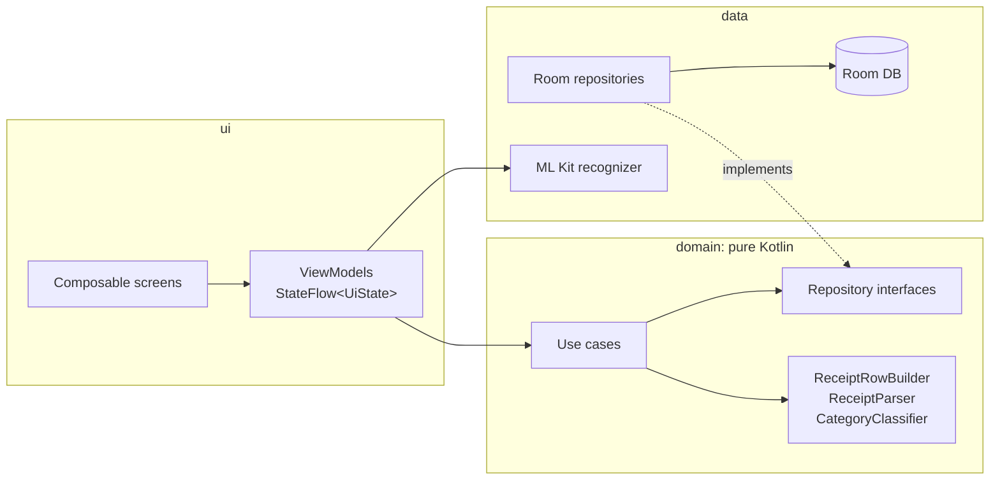

# MySavings

**Offline-first expense tracker for Android with on-device receipt scanning.**

Point the camera at a receipt and MySavings reads the store name, total, date and category on the phone itself, with no internet and no account. You review the result, save it, and the home screen shows how much of this month's budget is left.

> The app is in English by default and fully translated into Bahasa Indonesia; users switch in Settings. Adding a language is one `values-xx/strings.xml` file.

## Screenshots

<!-- Add images to docs/screenshots/ and reference them here. -->
| Home | Scan | Confirm |
|---|---|---|
| _coming soon_ | _coming soon_ | _coming soon_ |

## Features

- **Receipt scanning, fully offline**: CameraX capture + ML Kit text recognition (bundled model), parsed with rules tuned for Indonesian receipts (`TOTAL`, `GRAND TOTAL`, `JUMLAH`, `25.000`, `25.000,00`, `48,000.00`, `29 Okt 2026`, …).
- **Review before saving**: scanned values pre-fill the form; anything the scan could not read is flagged "Periksa kembali".
- **Monthly budget**: remaining budget with a progress bar that turns amber at 80% and red when overspent.
- **Spending by category and recent transactions** on the home screen, updated live.
- **Statistics**: six-month spending bars and a category donut, both drawn by hand on a Compose `Canvas`, with text descriptions for screen readers.
- **Budget alerts**: a notification at 80% and when the budget is used up, at most once per level per month. Checked in the background with WorkManager after every save and once a day.
- **PDF report**: export any month as a multi-page A4 PDF (summary, category table, every transaction) and share it to any app. Built with Android's own `PdfDocument`, shared through a `FileProvider`, no storage permission. [Sample report](docs/samples/contoh-laporan-60-transaksi.pdf) (test data, 2 pages).
- **Languages**: English (default) and Bahasa Indonesia, switchable in-app without a restart via the per-app language API (on Android 13+ also in system settings). Built-in category names, dates, notifications and the PDF follow the chosen language.
- **Manual entry** with a thousands-grouped amount field, a date picker that blocks future dates, and a category dropdown.
- **Private by design**: no `INTERNET` permission; photos are processed in memory and never written to storage.

## Tech stack

Kotlin · Jetpack Compose (Material 3) · Navigation Compose (type-safe routes) · MVVM · Hilt · Room · Coroutines & Flow · CameraX · ML Kit Text Recognition · JUnit 4 · MockK · Turbine · Gradle Kotlin DSL with a version catalog

## Architecture



- **`domain` has no Android imports.** Models, use cases and the receipt parser are plain Kotlin, so the logic most likely to break is tested on the JVM in milliseconds.
- **One `UiState` per screen.** Composables are stateless (`XxxScreen`) and previewable; a thin `XxxRoute` connects them to the ViewModel.
- **Room Flows all the way up.** The home summary `combine`s four queries, so the screen updates by itself whenever data changes.

### Decisions worth a closer look

| Decision | Why |
|---|---|
| Money is `Long` rupiah | No floating-point rounding errors; rupiah has no minor unit in practice. |
| `ReceiptRowBuilder` | OCR returns receipt columns as separate blocks ("TOTAL" … "99.330"). Grouping fragments by vertical position rebuilds the printed rows, without which the total cannot be found reliably. |
| Rule-based parser instead of an ML model | Instant, transparent, and every rule is pinned by a test with a realistic receipt. Mistakes are fixed on the Confirm screen. |
| Whole-word keyword matching, store name weighted ×3 | "tol" (toll road) must not match "toleransi"; a pharmacy that sells coffee is still a pharmacy. |
| Manual budget upsert | SQLite treats `NULL`s as distinct in unique indexes, so `@Upsert` would allow two "overall" budgets per month. |
| Scanned draft as a navigation argument | Survives rotation and process death. Encoded as URL-safe Base64 JSON so user text like `Kopi & Roti 100%` can't be corrupted by URL decoding (caught by an instrumented test). |
| Charts on `Canvas`, geometry in `ChartGeometry` | No chart library; bar heights and donut angles are plain functions with unit tests, the composables only draw them. |
| Room AutoMigration with a migration test | Adding the alerts table bumped the schema to v2. Room generates the migration from the committed schema files, and `MigrationTest` upgrades a real v1 database to prove no user data is lost. |
| Alert logic in the domain, WorkManager at the edge | `CheckBudgetAlertUseCase` decides (and is unit tested); the worker just runs it. Every reached level is recorded, so jumping from 50% to 120% sends one "used up" alert, never a late "nearly used". |
| PDF pagination as pure Kotlin | `ReportLayout` computes page breaks from fixed row heights before anything is drawn, so "Halaman 2 dari 3" is known up front and edge cases (exactly full page, zero rows) are unit tested. |
| Per-app language via AppCompat | `AppCompatDelegate.setApplicationLocales` is native on Android 13+ and back-ported to 10-12. Workers and the PDF writer have no Activity, so they get a context in the saved language explicitly. Bundle language splits are off so a language picked in-app is always installed. |
| Injected `Clock` | "Today" and "this month" are testable, including crossing midnight at month end. |

## Project structure

```
app/src/main/java/com/hanan/mysavings/
├─ data/      Room entities, DAOs, repositories, ML Kit recognizer, Hilt modules
├─ domain/    models, repository interfaces, use cases, receipt parser
└─ ui/        theme, navigation, components, home/, scan/, confirm/
```

## Build and test

Requires Android Studio (bundled JDK) and an Android 10+ device or emulator.

### Firebase setup

Google sign-in uses Firebase. The config file is project-specific and kept out of git, so a fresh clone needs its own:

1. Create a project in the [Firebase console](https://console.firebase.google.com) and add an Android app with package `com.hanan.mysavings` and your debug SHA-1 (`./gradlew signingReport`).
2. Enable **Authentication > Sign-in method > Google**.
3. Download `google-services.json` **after** step 2 (it must contain an OAuth client of `client_type: 3`) and put it in `app/`.

Without the file the build stops at the `google-services` plugin.

```bash
./gradlew assembleDebug                 # build the APK
./gradlew testDebugUnitTest             # JVM unit tests (parser, use cases, ViewModels)
./gradlew connectedDebugAndroidTest     # device tests (Room DAOs, navigation arguments)
./gradlew lintDebug
```

Release builds are shrunk with R8 and split per CPU type, because ML Kit's on-device OCR engine is a native library of 7-11 MB per ABI:

```bash
./gradlew assembleRelease   # app-arm64-v8a-release.apk ~17 MB (instead of one 50 MB APK)
./gradlew bundleRelease     # App Bundle for Play, which delivers only the device's ABI
```

## Roadmap

Development happens in phases; see [SPEC.md](SPEC.md) for the full spec.

- [x] 1. Foundation: Hilt, navigation, theme
- [x] 2. Data and domain: Room, repositories, use cases
- [x] 3. Home screen and manual entry
- [x] 4. Receipt scanning
- [x] 5. Scan confirmation and MVP polish
- [x] 6. Monthly charts, budget notifications (WorkManager), PDF export
