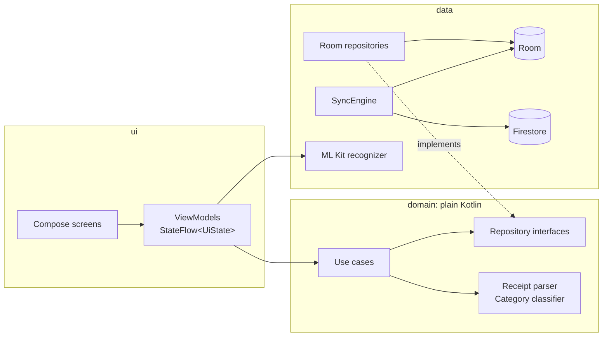

# MySavings

*[Baca dalam Bahasa Indonesia](README.id.md)*

A personal finance app for Android. You can track spending, save up for things you want, and keep tabs on debts you still need to pay.

I started it as a simple expense tracker that reads receipts with the camera. Over time it grew into four tabs: **Expenses**, **Savings**, **Debts** and **Profile**. It's a portfolio project, so I cared about how the code reads just as much as what the app does.

The app works offline. Receipt scanning runs on the phone itself, and all your data lives in a local database. Signing in with Google is optional and only adds sync between devices.

<!--
Screenshots: put PNGs in docs/screenshots/ and uncomment this table.

| Expenses | Scan | Savings | Debts |
|---|---|---|---|
|  |  |  |  |
-->

## What it does

### Expenses
- **Scan a receipt.** Take a photo and the app fills in the store, total, date and category. Text recognition runs on the device (ML Kit, bundled model), so it works on the first launch with no internet. The parsing rules are tuned for Indonesian receipts: `TOTAL`, `JUMLAH`, `25.000`, `25.000,00`, `29 Okt 2026` and so on.
- **Check before saving.** Anything the scan couldn't read properly is marked so you know what to look at.
- **Add, edit or delete** transactions by hand.
- **Monthly budget** with a progress bar, how much you can still spend per day, and a comparison with the same days last month.
- **Charts**: daily spending on the home screen, plus a stats screen with six months of totals and a breakdown by category. All drawn on a Compose `Canvas` without a chart library.
- **Budget alerts** at 80% and 100%, checked in the background with WorkManager. Each alert is sent at most once per month.
- **PDF report** for any month (summary, category table, every transaction), ready to share. [Here's a sample](docs/samples/contoh-laporan-60-transaksi.pdf).

### Savings
- Goals for things you want to buy, grouped by category (gadget, vehicle, travel, education and so on).
- Record deposits, see your progress, and optionally set a target date.

### Debts
- Personal debts, paid in one go or in installments.
- A calendar showing due dates, with the nearest payments listed underneath.
- Record payments and see what's left.
- Reminder notifications 3 days before a due date and on the day itself.

### Profile and sync
- Name and photo, stored on the device.
- Optional Google sign-in. Once signed in, data syncs through Firestore, so you see the same numbers on another phone with the same account.
- When signing out you choose to keep the data on the phone or remove it. You can also delete your account and its cloud data.

The app is in English by default and fully translated into Bahasa Indonesia. You can switch in Settings without restarting.

## Running it yourself

### What you need
- A recent Android Studio. The project uses AGP 9.4, so older versions won't sync it.
- A phone or emulator running Android 10 (API 29) or newer. A real phone is nicer for testing the camera.

### 1. Clone the repo

```bash
git clone https://github.com/mashanan/MySavings.git
```

### 2. Add your own Firebase config

Google sign-in uses Firebase, and the config file is tied to a Firebase project, so it isn't in the repo. **The build won't run without it**, even if you never plan to sign in.

1. Create a project in the [Firebase console](https://console.firebase.google.com) and add an Android app with the package name `com.hanan.mysavings`. Add your debug SHA-1 too (`./gradlew signingReport` prints it).
2. Go to **Authentication > Sign-in method** and turn on **Google**.
3. Now download `google-services.json` and put it in the `app/` folder. Do this *after* step 2, because the file only includes the OAuth client sign-in needs once Google is turned on.
4. Optional, for sync: create a **Firestore Database** and paste the contents of [`firestore.rules`](firestore.rules) into its Rules tab. These rules make sure each account can only read and write its own data.

### 3. Build and run

Open the project in Android Studio, wait for Gradle sync, and press Run. Or from the command line:

```bash
./gradlew assembleDebug     # APK ends up in app/build/outputs/apk/debug/
```

On Windows, use `gradlew.bat`. If `JAVA_HOME` isn't set, you can point it at the JDK that ships with Android Studio:

```powershell
$env:JAVA_HOME = "C:\Program Files\Android\Android Studio\jbr"
```

### Tests

```bash
./gradlew testDebugUnitTest             # unit tests on the JVM (about 300)
./gradlew connectedDebugAndroidTest     # Room, migration, sync and navigation tests, needs a device
./gradlew lintDebug
```

### Release builds

Release builds are shrunk with R8 and split per CPU type. ML Kit's OCR engine is a native library of 7 to 11 MB per architecture, so one APK per ABI is about 17 MB instead of 50 MB. There's no signing config in the repo yet, so you'll need to add your own keystore to install a release build.

## How it's built

**Stack:** Kotlin, Jetpack Compose (Material 3), Navigation Compose with type-safe routes, MVVM, Hilt, Room, Coroutines and Flow, WorkManager, CameraX, ML Kit Text Recognition, Firebase Auth with Credential Manager, Firestore. Tests use JUnit 4, MockK, kotlinx-coroutines-test and Turbine.



A few rules the code sticks to:

- **`domain` doesn't import Android.** Models, use cases and the receipt parser are plain Kotlin, so the logic most likely to break is tested on the JVM in milliseconds.
- **Room is the source of truth.** Screens read Room through Flows and update by themselves. Sync runs in the background and never blocks the UI, so the app behaves the same with or without a connection.
- **Screens come in pairs.** `XxxScreen` is stateless and has previews, while `XxxRoute` connects it to the ViewModel.

### Decisions worth a closer look

| Decision | Why |
|---|---|
| Money is a `Long` in whole rupiah | No floating-point rounding errors, and rupiah has no cents in practice. |
| Rule-based receipt parser, not an ML model | It's instant, easy to reason about, and every rule is covered by a test with a realistic receipt. When it gets something wrong, you fix it on the confirm screen. |
| Rebuilding receipt rows from OCR blocks | ML Kit returns columns as separate blocks ("TOTAL" in one, "99.330" in another). Grouping them by vertical position puts the printed rows back together. Without that, the total can't be found reliably. |
| One form for add, scan and edit | Same fields, same validation, same "discard changes?" dialog. Edit mode is just an extra `transactionId` argument. |
| Sync rows carry a `uuid` next to the local `id` | The local id stays fast for joins and foreign keys, but means nothing on another phone. The uuid is how devices and the cloud recognise the same row. |
| Deletes leave a tombstone | Otherwise a deleted row would come back on the next download from a phone that still has it. |
| The newest change wins, using server time for downloads | Simple and predictable for a single-user app. A server timestamp means a phone with the wrong clock can't skip changes. |
| Profile photo as a Firestore `Blob` | A small, compressed avatar fits in one document, so the project doesn't need paid Cloud Storage. |
| Injected `Clock` everywhere | "Today" and "this month" can be tested, including the moment a month rolls over at midnight. |
| Alert logic in the domain, WorkManager at the edges | Use cases decide whether to send a budget or debt reminder (and are unit tested). The workers just run them. |
| PDF page layout in plain Kotlin | Page breaks are worked out before anything is drawn, so "Page 2 of 3" is known up front, and edge cases like an exactly full page are unit tested. |
| Room migrations with committed schemas | The schema is at version 6. `MigrationTest` upgrades real older databases to prove no data is lost. |

## Project structure

```
app/src/main/java/com/hanan/mysavings/
├─ data/          Room, repositories, ML Kit, Firebase Auth, sync, Hilt modules
├─ domain/        models, repository interfaces, use cases, receipt parser
├─ notification/  WorkManager workers for budget and debt reminders
├─ export/        PDF report
└─ ui/            one package per tab (home, savings, debts, profile) plus scan, confirm, stats, settings
```

The full spec, data model and the phase-by-phase plan are in [SPEC.md](SPEC.md) (in Indonesian).

## Status

All planned phases are done, from the first Room setup through sync, account deletion, and editing and deleting transactions. Ideas I'd like to try next:

- Income tracking, so the home screen can show what's actually left this month
- Recurring transactions for monthly bills
- CI with GitHub Actions
- A signed release build

## Privacy

Without signing in, nothing leaves your phone. Receipt photos are processed in memory and never saved. If you sign in, your data is copied to your own space in Firestore (`users/{your uid}/...`), and the security rules stop anyone else from reading it.
